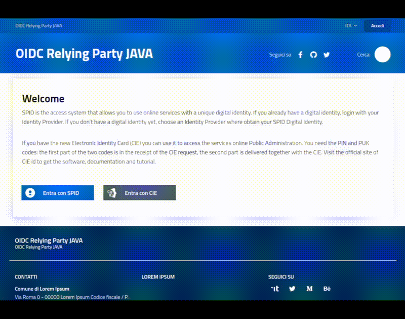

# SPID/CIE OIDC Federation, for Java

[](https://slack.developers.italia.it/)
[](https://developersitalia.slack.com/archives/C7E85ED1N/)

[](https://docs.oracle.com/en/java/javase/21/docs/api/)
[](https://github.com/alfredodand/spid-cie-oidc-java/actions/workflows/codeql.yml)

> ⚠️ **This is NOT the original project.** This repository is a **re-engineered fork**
> of [`italia/spid-cie-oidc-java`](https://github.com/italia/spid-cie-oidc-java),
> maintained by `alfredodand`, in which:
> - **all dependencies have been updated** to their latest stable versions,
> - the project has been **migrated from the SAML protocol to OpenID Connect (OIDC)**.
>
> See the [License and Authors](#license-and-authors) section for the full details.

**SPID/CIE OIDC Federation (for Java)** is a **starter kit** and **example projects** designed to ease the creation of an OpenID Connect Federation.

> ⚠️ This project is a work-in-progress. Currently only the **Relying Party** role has been completed.
>
> 👀 Watch this repository over GitHub to stay informed.

**SUMMARY**

* [Features](#features)
* [Requirements](#requirements)
* [Usage](#usage)
* [Build](#build)
* [Docker](#docker)
* Example projects
  * [SpringBoot Relying Party example](#springboot-relying-party-example)
* [Useful links](#useful-links)
* Contribute
  * [Contribute as end user](#contribute-as-end-user)
  * [Contribute as developer](#contribute-as-developer)
* [License and Authors](#license-and-authors)

## Features

The purpose of this project is to provide a simple and immediate tool to integrate, in a WebApp developed with any Java Framework, the authentication services of SPID and CIE, automating the login/logout flows, the management of the OIDC-Core/OIDC-Federation protocols and their security profiles, and simplify the development activities.

It contains a _[starter-kit](starter-kit/)_ — a Java library that exposes utilities, _helpers_ and _handlers_ you can include in your application in order to support the SPID/CIE OpenID Connect Authentication profile and OpenID Federation 1.0.

The library is developed using **Java 21** with a "Low Level Java" approach to limit dependencies and to allow it to be included into projects made with high-level frameworks like Spring, SpringBoot, OSGi, Quarkus and many other Java-based frameworks.

Currently only the "**OpenID Connect Relying Party**" role is managed. The starter-kit provides:

* Federation Entity JWKS and Metadata creation
* OIDC Federation onboarding
* SPID and CIE OpenID Connect login and logout
* UserInfo claims retrieving
* Build (discover) TrustChain of OPs
* Multitenancy
* See [docs/USAGE.md](docs/USAGE.md) for a more detailed list

The "**OpenID Connect Provider**" role is still a work in progress. Several requirements are already covered by the current starter-kit and the missing aspects should not require much effort.

There are no plans to extend the starter-kit to allow you to implement an "**OpenID Connect Federation**" Server.



## Requirements

* [Java](https://openjdk.java.net/) **21** (or higher)
* [Maven](https://maven.apache.org/) (the included `mvnw` wrapper is recommended)

## Usage

Both Snapshots and Released artifacts are available on [GitHub Packages](https://github.com/orgs/alfredodand/packages?repo_name=spid-cie-oidc-java):

* if you use Maven

```xml
<dependency>
  <groupId>it.spid.cie.oidc</groupId>
  <artifactId>it.spid.cie.oidc.starter.kit</artifactId>
  <version><!--replace with the wanted version --></version>
</dependency>
```

* if you use Gradle

```gradle
implementation group:'it.spid.cie.oidc', name:'it.spid.cie.oidc.starter.kit', version: 'wanted-version'
```

As stated in the [documentation](https://docs.github.com/en/packages/working-with-a-github-packages-registry/working-with-the-apache-maven-registry#authenticating-to-github-packages), to use GitHub Packages you have to define the GitHub repository in your `~/.m2/settings.xml` together with your credentials.

The "starter-kit" is a _backend_ library with very few dependencies:

* [`org.json:json`](https://github.com/stleary/JSON-java), a simple and lightweight library to parse and create JSON documents
* [`com.nimbusds:nimbus-jose-jwt`](https://connect2id.com/products/nimbus-jose-jwt), the most popular Java library to manage JSON Web Tokens (JWT, JWE, JWS)
* [`org.slf4j:slf4j-api`](https://mvnrepository.com/artifact/org.slf4j/slf4j-api)

Go [here](docs/USAGE.md) for more detailed information.

## Build

From the repository root, build and test the whole multi-module project:

```bash
./mvnw clean install
```

This compiles:

* `starter-kit/` — the core library (`it.spid.cie.oidc.starter.kit`)
* `examples/` — the SpringBoot Relying Party sample
* `coverage/` — the JaCoCo coverage report module

To generate the code coverage report as well:

```bash
./mvnw clean package -Pcoverage
```

## Docker

The "starter-kit" is a library.

Sample projects using the library can be executed as Docker or Docker Compose. See the example documentation.

## Example projects

### SpringBoot Relying Party example

A simple [SpringBoot](examples/relying-party-spring-boot/) web application using the starter-kit to implement a Relying Party, as well as to perform the complete onboarding and login/logout test within the CIE Federation.

This application is for demo purposes only; please don't use it in production or critical environments.

To run it locally, start the [federation](https://github.com/italia/spid-cie-oidc-django) and then:

```bash
cd examples/relying-party-spring-boot
../../mvnw clean spring-boot:run
```

The example starts on [http://127.0.0.1:5000](http://127.0.0.1:5000). See the [example README](examples/relying-party-spring-boot/README.md) for the full onboarding walkthrough.

It exposes the following HTTP endpoints (under `/oidc/rp/`):

* `.well-known/openid-federation` — publishes the federation entity configuration
* `authorize` — starting point of the SPID/CIE authentication flow
* `callback` — where the authorization code lands
* `logout` — starts the token revocation flow
* `landing`, `echo_attributes`, `policy`, `resolve` — demo pages and helpers

The sample uses **H2** as the database engine and Spring Data JPA to implement the `PersistenceAdapter` interface.

## Useful links

* [OpenID Connect Federation](https://openid.net/specs/openid-connect-federation-1_0.html)
* [SPID/CIE OIDC Federation SDK](https://github.com/italia/spid-cie-oidc-django)

## Contribute

Your contribution is welcome, no question is useless and no answer is obvious, we need you.

#### Contribute as end user

Please open an issue if you've discovered a bug or if you want to ask for some features.

#### Contribute as developer

This repository follows a [Trunk based Development](https://trunkbaseddevelopment.com/) approach:

* __main__ branch contains the evolution of the project, where developed code is merged
* __x-branch__ are short-lived feature branches always connected to one or more issues (to better track and motivate requirements)

At the moment there is a GitHub Action allowing [releasing from Trunk](https://trunkbaseddevelopment.com/release-from-trunk/).

Please open your Pull Request on the __main__ branch, but before starting to code open an issue to describe your needs and inform the Team you are working on it.

In this project we adopt [Semver](https://semver.org/lang/it/) and
[Conventional commits](https://www.conventionalcommits.org/en/v1.0.0/) specifications.

## License and Authors

This software is released under the [Apache 2 License](LICENSE).

### Original project

The original project is **not** this repository. It was originally authored and released by:

- Mauro Mariuzzo <mauro.mariuzzo@smc.it>

as part of [`italia/spid-cie-oidc-java`](https://github.com/italia/spid-cie-oidc-java).

### This fork / re-engineering

This repository is a **re-engineered fork**, **not** the original project. It is maintained by:

- **alfredodand**

The re-engineering work consists of:

* **updating all dependencies** to their latest stable versions (Java 21, Spring Boot 3.5.x, Nimbus JOSE JWT, `org.json`, SLF4J, etc.),
* **migrating the protocol from SAML to OpenID Connect (OIDC)**.

This is a derivative work: the original code is licensed under the Apache License 2.0 and all notices have been retained in accordance with the license terms.
